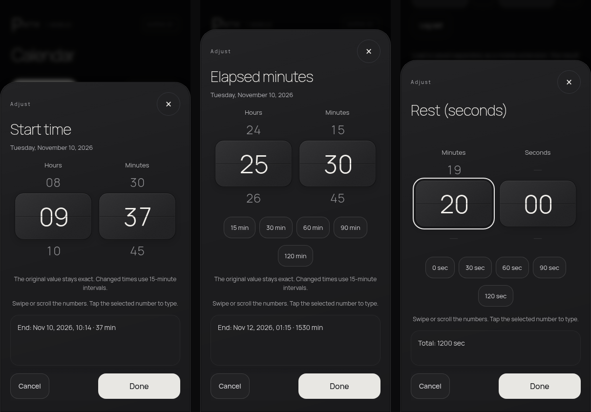

# Path Mobile — числовые и временные селекторы

Общая система Time / Duration / Integer / Decimal внедрена в существующие подходящие поля. HTML `PATH_NUMERIC_PICKERS_DEMO.html` использован как источник характера поверхности и перекидного движения; его демонстрационная модель не перенесена в приложение.

Исходная рабочая копия: `Valdemarouki/Path`, `/workspace/Path`, `feature/path-mobile-alpha`, HEAD `6e7f9c7f21577ff757d5a84297791326147ff8b3`, чистое дерево. Существующий проверенный checkpoint этого HEAD актуален. Файлы предыдущих этапов и история сохранены; reset/clean/clone не применялись.

## Аудит и внедрение

Полная таблица: [AUDIT.md](AUDIT.md). В ней приведены файл/компонент, назначение, единица, диапазон, шаг, прежний control и решение для всех найденных мест, включая места без поддерживаемого числового редактора.

| Семейство | Внедрено |
|---|---|
| Time | Calendar start, Calendar end time, Sport plan time |
| Duration h/min | Calendar elapsed duration, Today/Quick Add task duration, Sport template duration |
| Duration min/s | Rest в редакторе упражнения |
| Integer | Количество подходов, фактические повторения |
| Decimal | Фактические секунды/kg и необязательная нагрузка kg; одно значение, не колесо на цифру |

Сохранены даты/дедлайны в календарных controls; категориальные selects типа, важности, статуса, единицы, fold, языка, motion и периода; weekday checkboxes; текстовая спортивная prescription `8–12`; computed timers/progress и Canvas pan/zoom. Не добавлены отсутствующие numeric habit goals, distance, reminder/recurrence editors или kg/lb conversion. Ограниченные desktop-first поля продолжают сохраняться read-only.

Время текущего Calendar задаётся `hourCycle:'h23'` в `mobile/app.mjs`. Новые адаптеры сохраняют **24 часа во всех трёх языках**, AM/PM не показывают. Компонент умеет принимать `hour12:true` и прошёл отдельную проверку noon/midnight; настройки 12/24 в приложении сейчас нет, новый переключатель не придуман.

## Данные и вложенный шаг

Диапазоны и финальная валидация взяты из текущих `mobile/model.mjs`, `mobile/calendar-model.mjs`, `mobile/alpha-model.mjs`; эти модели **не изменены**. Calendar новые/перенесённые интервалы остаются по 15 минут. Существующие off-grid 09:37 / 37 минут открываются точно; Done без изменения сохраняет исходное представление и не отправляет input/change. Изменённое значение должно соответствовать прежним правилам. В Duration доступно до 10080 минут / 168 часов, без ограничения часами суток.

Переход через полночь показывает фактическую дату окончания. Предпросмотр использует существующие IANA zone/fold, `wallCandidates` и `durationFromEnd`, не новую календарную арифметику. Deadline 0 остаётся disabled, rest 0 и load 0 допустимы, optional task/load сохраняют различие отсутствия и нуля.

Модель спортивных дробных значений допускает любую конечную точность в заданном диапазоне. Поэтому ±1 — удобный переход, **не новый шаг квантования**: 12.375 → 13.375 → 12.375. Прямой ввод принимает точку/запятую, не отбрасывает fractional seconds. Очень маленькие числа отображаются научной записью вместо ложного нуля. Единицы не переименовываются с изменением физического смысла.

В открытом редакторе селектор — временный view внутри **того же dialog**: исходная форма hidden/inert, её DOM, значения и scroll сохраняются. Done обновляет только исходный input; Cancel/Escape восстанавливают вид без изменения поля. Основной Save/Log set остаётся отдельной операцией и единственным источником записи. Промежуточные поля селектора исключены из dirty snapshot, поэтому Cancel не создаёт ложный запрос discard.

Для inline workout input используется один экземпляр того же modal surface; отдельная панель поверх открытого редактора не создаётся. После закрытия возвращается фокус на кнопку поля. Исходные inputs сохранены для клавиатуры и прямого ввода, дополнены доступной кнопкой 44 px. На 320 px тесные пары числовых полей переходят в одну колонку. Скрытая родительская форма не участвует в фокусе; picker — один набор доступных controls, декоративные flap-половинки aria-hidden. Изменения кадров не отправляются в live region.

## Материал и движение

Локальный Manrope сохранён вместе с OFL; в реальном TTF подтверждён OpenType `tnum`. У чисел tabular-nums, фиксированные карточки/колонки, графитовый градиент, тёмный край, тонкий шов 1 px и слабый static noise (слой opacity 0.04). Крупный шов или белое свечение не перекрывают цифры. Предпросмотр имеет зарезервированную высоту: изменение длительности не перемещает соседнюю колонку, заголовок и кнопки.

- Медленное перелистывание: старая половина 100 ms; новая начинает на 90 ms и заканчивает ещё через 150 ms — весь переход **240 ms**. Направление меняется вместе со значением; половинки принадлежат соответствующему старому/новому полному значению.
- Быстрое движение: без очереди 3D flip; текущее число следует вводу с коротким **100 ms** opacity/5 px feedback. Старые слои отменяются.
- Wheel: **24 CSS px / шаг**, не более 6 переходов за одно большое событие; лишний накопленный delta отбрасывается. Reverse не должен сначала «погасить» старую очередь.
- Touch: **30 CSS px / шаг**, движение только над числом. После отпускания — ограниченная инерция до **6 шагов / 180 ms**, затем мягкое возвращение до **2 px / 200 ms**. Это не постоянный animation loop.
- Клавиши: ArrowUp/Down, PageUp/Down, Home/End; Enter/Space открывают прямой ввод. Соседнее значение можно нажать; у integer/decimal есть −/+.
- OS reduced motion и Path Motion Off отключают 3D, пространственное следование, инерцию и возврат. Значения и ошибки остаются понятны. При visibility change, новом жесте, закрытии и смене route анимации/RAF отменяются.

Нижняя панель, её материал/порядок/трансформация и Calendar completion/IMPACT не редактировались.

## Проверка

**Финально 20/20 suites PASS**, включая 86 model cases (6 новых), 27 новых browser integration groups, все прежние Calendar/completion/IMPACT/navigation/functional/action suites и typography preview. Дополнительный окончательный numeric pass также 27/27; в уменьшенном viewport проверены реальные координаты и поля, и Done, а не только наличие в DOM. Числа считаются разными единицами — model case, flow и matrix group; это не сотни независимых ручных проверок. Все новые browser contexts завершились без page exceptions, console errors/warnings, HTTP errors и внешних запросов.

[Общий результат](validation/summary.json), [логи](validation/test-results.txt), [окончательные numeric scenarios](validation/numeric-focused.json), [исходный прерванный прогон](validation/interrupted-summary.json), [точные HTTP-ошибки](validation/interrupted-http-errors.log), [font/reference provenance](validation/provenance.json).



[Time RU 320](screens/time-ru-320.png), [Decimal RU 320](screens/decimal-ru-320.png), [Manual RU 320×390](screens/manual-ru-320x390.png). Остальные комбинации EN/RU/ES × 320/390/430 находятся в screens.

[Видео реального взаимодействия, обычная скорость](numeric-picker-interaction.mp4) / [GIF](numeric-picker-interaction.gif), около 7 секунд: медленный flip, быстрый wheel, reverse, touch, возврат к исходному редактору и Duration. Это Chromium screencast, не сгенерированные цифры или постановочная анимация вне приложения.

Первый Calendar smoke и все 72 существующих Calendar editor cases прошли до проверки остальных адаптеров. Новые сценарии покрывают:

- EN/RU/ES × 320/390/430; exact legacy opening/Done/Cancel, отсутствие fake dirty, возврат фокуса и отсутствие overflow;
- длительность более суток, фактическую следующую дату, редактор окончания, final save/reload, сохранность ID/instants/unknown fields;
- медленный/быстрый wheel, немедленный reverse, wheel за пределами цифр, реальные CDP touch events, ограниченную инерцию и touchCancel;
- ручной ввод/ошибки/границы, запятую, произвольную дробную точность, 0 и отсутствие значения, kg/seconds/reps, rest 0/1200, sets 1/30;
- неизменность active/planned snapshots при правке template, сохранение текста `8–12`, поля task/plan/workout duration;
- focus containment, Escape из manual и всего шага, viewport 320×390 при ручном вводе, OS/Path motion, отсутствие оставшихся flap/animations;
- standalone route cancellation и отдельную компонентную проверку 12h/AM-PM без добавления app preference.

Во время общего прогона среда сообщила `starting`. Файлы и HEAD сохранились, но localhost 8010/8020 начали возвращать `ERR_EMPTY_RESPONSE`. Это зафиксировано отдельно; причина внутреннего перезапуска не установлена. Выполнено штатное переподключение, перезапущены только два Python static preview процесса, HTTP 200 проверен. Все восемь прерванных suites успешно повторены; ранее прошедшие сохранены, numeric suite также повторён с окончательной слабой интенсивностью noise. Сбой HTTP не назван ошибкой приложения и не замаскирован в summary.

Физические iOS/Android, Safari/WebKit, экранные дикторы, реальная IME/системная клавиатура и производительность на телефоне не проверены. Это Linux Chromium с синтетическими профилями, touch/keyboard/viewport эмуляцией и только loopback-запросами. Сохранение при quota/stale tab и существующая completion wave покрываются также прежними мобильными suites.

## Повторный запуск и файлы

```bash
cd /workspace/Path
python3 mobile/build.py
python3 -m http.server 8010 --bind 127.0.0.1 --directory mobile/dist
# В другом терминале, с уже установленными Playwright/Chromium:
MOBILE_NUMERIC_EVIDENCE=/tmp/path-numeric-check node mobile/tests/numeric-pickers.cjs
node --test mobile/tests/numeric-values.test.mjs
```

Для полного прогона: `python3 mobile/typography-preview/build.py`, второй loopback server 8020 с `--directory mobile/typography-preview/dist`, затем `node mobile/tests/run-polish.cjs --evidence /tmp/path-numeric-full --with-typography`. Приложению не нужны npm install или Node; для static build/serve достаточно Python 3.

Полный список относительно исходного HEAD — [CHANGED_FILES.txt](CHANGED_FILES.txt). Локальные коммиты: `f4cfad665a92a82d2a70d09fffed72a6588d7e5a` — общий компонент/арифметика/стили/unit tests; `f3e74d5797a0eaf5cdfe0df39626c9f0e0acd38e` — адаптеры форм/сборки/регрессионные browser tests. Отдельный commit документации и полный конечный HEAD указаны в итоговом ответе и delivery metadata. Финальный clean status проверяется после коммита доказательств.

Обновлённые source archive, полный bundle и готовый Windows ZIP с SHA256SUMS создаются вне репозитория для итогового HEAD. Они проверяются отдельно от рабочей копии. Для ZIP: Python 3 + Chrome/Edge; новая папка `C:\PathMobile-Numeric-Test\Path-Mobile` с `index.html`, команда `py -3 -m http.server 8016 --bind 127.0.0.1 --directory "C:\PathMobile-Numeric-Test\Path-Mobile"`, адрес `http://127.0.0.1:8016/`. Node для ZIP не нужен. Порт и тестовый профиль отдельные от старого прототипа; ничего не импортируется. Архивы/снимки до скачивания остаются внутри среды и не являются внешней резервной копией.

Desktop, AGENTS.md, корневые настройки/lockfiles, Paperclip, Daytona, production, реальные пользовательские данные, main и paperclip-test не изменены. Push, PR, merge, deployment и публикации среды не было.
